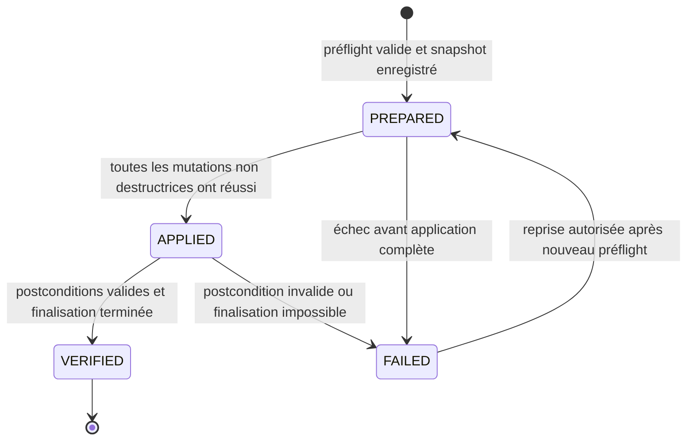

# Administration historique — spécification de fiabilisation

- Statut : version 0.1, prête pour découpage en lots d’implémentation
- Date : 17 septembre 2026
- Périmètre : administration du catalogue BD historique portée principalement par `mvc/controllers/Admin.php`
- Objectif : empêcher les mutations accidentelles ou partielles et rendre les opérations sensibles vérifiables et récupérables

## 1. Décision directrice

La modernisation commence par la fiabilité des traitements, pas par une refonte visuelle.

Une opération administrative sensible doit désormais être :

1. explicitement déclenchée par un formulaire authentifié ;
2. validée côté serveur au moment de son exécution ;
3. sérialisée afin d’éviter deux traitements concurrents incompatibles ;
4. journalisée avant toute modification ;
5. découpée en étapes rejouables ;
6. vérifiée avant la suppression des données ou fichiers sources ;
7. présentée à l’administrateur avec un résultat compréhensible et un identifiant d’opération.

La première tranche verticale porte sur la fusion de deux albums. Elle sert de preuve de fonctionnement avant l’extension aux éditions, auteurs, éditeurs, suppressions et splits.

## 2. Problème utilisateur

Les administrateurs et correcteurs doivent maintenir un catalogue ancien comportant de nombreuses relations avec les collections des membres. Aujourd’hui, une URL forgée, une validation incomplète ou une erreur à mi-traitement peut provoquer une mutation non souhaitée ou laisser les données et couvertures dans un état incohérent.

Le résultat attendu est observable :

- aucune mutation n’est possible par une simple navigation `GET` ;
- une source ne peut jamais être fusionnée avec elle-même ;
- l’écran annonce les impacts avant confirmation ;
- une erreur ne déclenche pas les étapes destructrices restantes ;
- un traitement interrompu peut être diagnostiqué puis repris sans répéter les étapes déjà validées ;
- l’administrateur obtient un résultat et une référence d’opération, sans message SQL ni sortie de débogage.

## 3. Hypothèse à vérifier

Un protocole commun appliqué d’abord à la fusion d’albums suffit à sécuriser les traitements les plus risqués sans réécrire le contrôleur complet.

Cette hypothèse est validée si la fusion pilote :

- passe tous les scénarios d’échec et de reprise définis dans cette spécification ;
- reste utilisable par l’équipe sans procédure manuelle complexe ;
- peut ensuite être adaptée à la fusion d’éditions avec peu de code spécifique supplémentaire.

## 4. Périmètre

### 4.1 Inclus dans cette étape

- garde commune d’accès aux mutations de l’Admin historique ;
- méthode HTTP `POST` obligatoire et protection CSRF ;
- validation serveur stricte des identifiants et des relations ;
- page de confirmation présentant les impacts ;
- verrou applicatif des opérations destructrices ;
- journal des opérations sensibles ;
- protocole d’exécution par étapes et reprise contrôlée ;
- sécurisation des copies, renommages et suppressions de couvertures ;
- redirection après mutation et messages de résultat ;
- tests automatisés des invariants critiques ;
- déploiement progressif traitement par traitement.

### 4.2 Hors périmètre

- modification fonctionnelle de l’administration Para-BD ;
- refonte complète de la navigation ou de l’identité visuelle de l’Admin ;
- changement de framework MVC ;
- remplacement global de la couche d’accès aux données ;
- refonte générale des rôles et ACL ;
- réécriture immédiate des formulaires d’édition ordinaires ;
- modification des règles publiques du catalogue ou des collections.

Des helpers techniques déjà présents dans le projet peuvent être généralisés et réutilisés, à condition de ne pas modifier le comportement de leur domaine d’origine.

## 5. Vocabulaire

- **Mutation** : requête qui crée, modifie, fusionne, déplace ou supprime une donnée ou un fichier.
- **Opération sensible** : mutation portant sur plusieurs lignes, plusieurs tables ou des fichiers.
- **Source** : entité destinée à être absorbée, déplacée ou supprimée.
- **Cible** : entité conservée à l’issue du traitement.
- **Préflight** : contrôle sans mutation calculant la faisabilité et les impacts.
- **Snapshot** : photographie des données nécessaires pour diagnostiquer ou reprendre une opération.
- **Étape destructive** : suppression physique d’une ligne ou d’un fichier source.
- **Postcondition** : règle vérifiée après application du traitement.

## 6. Règles communes aux mutations

### 6.1 Accès et méthode HTTP

- Les pages de consultation et de confirmation utilisent `GET`.
- Toute mutation utilise exclusivement `POST`.
- Une tentative de mutation par une autre méthode retourne le statut HTTP `405`.
- Le contrôle d’accès historique `User::minAccesslevel(1)` reste le minimum requis pour cette première étape.
- La décision de distinguer ultérieurement correcteurs et administrateurs destructifs reste indépendante de cette spécification.
- Le contrôle d’accès est exécuté avant le chargement des données sensibles et avant toute sortie HTML.

### 6.2 Protection CSRF

- Chaque formulaire de mutation contient un jeton CSRF lié à la session et au périmètre `admin-catalogue`.
- Le jeton est vérifié avec une comparaison résistante aux attaques temporelles.
- Un jeton absent ou invalide retourne `403` et ne produit aucune mutation.
- Le bouton de confirmation JavaScript peut compléter cette protection, mais ne la remplace jamais.

### 6.3 Lecture des entrées

- Les identifiants utilisent `getValInteger()` pour la consultation et `postValInteger()` pour la mutation.
- Tout identifiant doit être strictement supérieur à zéro.
- Les valeurs contrôlant une branche métier sont comparées à une liste explicite de valeurs autorisées.
- Les tableaux POST sont vérifiés comme tableaux, normalisés en entiers, dédupliqués puis filtrés.
- Aucun nom de fichier ou chemin fourni par le navigateur n’est considéré comme une source fiable.

### 6.4 Réponses HTTP

- `403` : accès ou jeton CSRF invalide ;
- `404` : source ou cible introuvable ;
- `405` : méthode HTTP interdite ;
- `409` : opération concurrente ou état devenu incompatible ;
- `422` : saisie valide syntaxiquement mais refusée par une règle métier ;
- `500` : erreur technique inattendue, journalisée côté serveur.

Après succès, le contrôleur applique le cycle POST–Redirect–GET. Les balises META de redirection, `var_dump()`, `echo` de progression et `exit()` dispersés ne font pas partie du nouveau protocole.

## 7. Journal des opérations sensibles

Une table `admin_operation` conserve l’état des fusions, splits et suppressions multi-étapes.

| Information | Règle |
|---|---|
| identifiant | identifiant technique immuable affichable à l’administrateur |
| type | code autorisé tel que `MERGE_ALBUM`, `MERGE_EDITION`, `SPLIT_EDITION` |
| source et cible | type d’entité et identifiants normalisés |
| clé d’idempotence | empêche de créer deux exécutions pour une même confirmation |
| statut | `PREPARED`, `APPLIED`, `VERIFIED` ou `FAILED` |
| étape courante | code de la dernière étape terminée |
| snapshot | données avant traitement utiles au diagnostic et à la reprise |
| progression | compteurs et résultats des étapes déjà appliquées |
| erreur | code interne et message technique non affiché directement |
| acteur | identifiant du compte ayant confirmé l’opération |
| dates | création, début, dernière mise à jour et fin |

### 7.1 États

- `PREPARED` garantit qu’aucune mutation métier n’a encore été appliquée.
- `APPLIED` garantit que les déplacements et remplacements sont terminés, mais pas nécessairement le nettoyage final.
- `VERIFIED` est le seul état de succès final.
- `FAILED` interdit toute continuation automatique. La reprise est une nouvelle action explicite et journalisée.

### 7.2 Idempotence

- Chaque étape possède un code stable et vérifie son résultat avant de s’exécuter.
- Une étape déjà terminée avec ses postconditions satisfaites est ignorée lors d’une reprise.
- Une double soumission du formulaire retourne l’opération existante au lieu d’en créer une seconde.
- Les compteurs enregistrés ne servent pas de preuve unique : l’état réel est relu avant chaque reprise.

## 8. Verrou applicatif

- Une seule opération destructive de catalogue peut être exécutée à la fois dans la première version.
- Le verrou est acquis côté base avec un nom stable avant le passage de `PREPARED` à l’application.
- L’attente est courte ; si le verrou est indisponible, la requête retourne `409` avec le message « Une autre opération administrative est en cours ».
- Le verrou est libéré dans un bloc `finally`, y compris en cas d’exception.
- Le verrou ne bloque pas la consultation publique du site.
- Les contrôles métier sont rejoués après acquisition du verrou, car l’état a pu changer depuis l’écran de confirmation.

## 9. Première tranche verticale : fusion d’albums

### 9.1 Consultation et préflight

La page de comparaison reste accessible en `GET` avec deux identifiants entiers : album source et album cible.

Le serveur vérifie :

- que les deux albums existent ;
- qu’ils sont distincts ;
- que la cible possède une édition par défaut valide ;
- que les éditions, commentaires, exclusions, sélections et références utilisateur à déplacer peuvent être comptés ;
- qu’aucune autre opération active ne cible déjà la source ou la cible.

L’écran affiche au minimum :

- titre, série et numéro de tome des deux albums ;
- édition par défaut de la cible ;
- nombre d’éditions à déplacer ;
- nombre de commentaires, exclusions et sélections concernées ;
- nombre de références dans les collections ;
- avertissement explicite indiquant quel album sera conservé ;
- formulaire `POST` avec jeton CSRF et identifiants source/cible.

Les impacts affichés sont informatifs. Ils sont recalculés après confirmation.

### 9.2 Invariants bloquants

La fusion est refusée si :

- la source ou la cible est absente ;
- la source et la cible sont identiques ;
- la cible n’a pas d’édition par défaut utilisable ;
- une édition sélectionnée n’appartient pas à la source ;
- une relation nécessaire ne peut pas être relue ;
- une opération incompatible est déjà active ;
- le snapshot ne peut pas être enregistré.

Aucun simple `header('Location: ...')` ne constitue une validation. Après un refus, le traitement retourne immédiatement sans poursuivre les mutations.

### 9.3 Étapes d’exécution

Ordre de référence :

1. acquérir le verrou applicatif ;
2. refaire le préflight ;
3. créer l’opération `PREPARED` et son snapshot ;
4. déplacer ou dédupliquer les commentaires ;
5. déplacer ou dédupliquer les sélections et exclusions ;
6. rattacher les références des collections à une édition valide de destination selon une règle déterministe ;
7. rattacher les éditions conservées à l’album cible ;
8. vérifier les compteurs et l’absence de références non traitées ;
9. passer l’opération à `APPLIED` ;
10. traiter les couvertures préparées ;
11. supprimer les seules éditions explicitement non conservées ;
12. supprimer l’album source uniquement si toutes les postconditions sont vraies ;
13. vérifier à nouveau l’état final ;
14. passer l’opération à `VERIFIED` ;
15. libérer le verrou et rediriger vers l’album cible avec un message de succès.

### 9.4 Gestion des doublons dans les collections

Une mise à jour silencieusement ignorée n’est pas considérée comme un succès.

Lorsque le membre possède déjà l’édition de destination :

- une seule ligne finale est conservée ;
- les attributs personnels ne sont jamais écrasés arbitrairement ;
- les conflits de données personnelles sont comptés et appliqués selon une règle documentée avant implémentation ;
- faute de règle certaine pour un champ, la fusion est refusée et l’opération passe à `FAILED` avant suppression de la source.

La règle précise de rapprochement des attributs personnels doit être confirmée à partir des usages réels avant d’implémenter cette sous-étape.

### 9.5 Postconditions

Avant la suppression de l’album source :

- aucune édition à conserver ne référence encore la source ;
- aucune référence de collection destinée à être migrée ne pointe vers une édition supprimée ;
- les commentaires, exclusions et sélections ont un album valide ;
- l’édition par défaut de la cible appartient bien à la cible ;
- les fichiers de couverture destinés à être conservés existent à leur emplacement préparé ;
- les compteurs réels correspondent aux résultats enregistrés ou à une déduplication expliquée.

Si une postcondition échoue, la source et les fichiers sources ne sont pas supprimés.

## 10. Sécurisation des fichiers image

### 10.1 Entrées autorisées

- Le nom courant d’une couverture est relu depuis l’édition en base.
- L’identifiant d’édition fourni par le formulaire est converti en entier puis contrôlé par rapport à l’album source.
- Les chemins absolus, segments `..`, octets nuls et liens symboliques sont refusés.
- Le chemin canonique doit rester sous le répertoire de couvertures attendu.
- Les extensions et types autorisés sont explicitement listés.

### 10.2 Protocole de remplacement

1. valider le fichier source ;
2. créer une copie temporaire avec un nom généré par le serveur ;
3. vérifier que la copie est lisible et correspond à une image autorisée ;
4. appliquer la mutation en base ;
5. vérifier que la nouvelle référence est valide ;
6. finaliser le nom de destination ;
7. supprimer l’ancien fichier seulement après succès complet.

Une erreur laisse en place le fichier source. Les fichiers temporaires sont nettoyés de façon indépendante et ne sont jamais considérés comme une preuve de succès métier.

### 10.3 Import par URL

Tout composant partagé d’import distant doit :

- accepter uniquement HTTP et HTTPS ;
- refuser les adresses locales, privées et réservées ;
- contrôler chaque redirection ;
- fixer des délais de connexion et de téléchargement ;
- limiter le nombre d’octets et de pixels ;
- vérifier la cohérence du type MIME et de l’image décodée ;
- produire un fichier local avant toute modification du catalogue.

## 11. Expérience administrateur minimale

Cette étape ne redessine pas l’Admin. Elle améliore uniquement les moments critiques :

- boutons explicites « Fusionner » et « Annuler » au lieu d’un lien `conf=ok` ;
- source et cible toujours nommées « Supprimé » et « Conservé » ;
- impacts visibles avant confirmation ;
- bouton désactivé après soumission afin d’éviter le double clic ;
- message de succès avec lien vers la cible et identifiant d’opération ;
- message d’échec en français, sans détail SQL, avec identifiant d’opération ;
- page protégée de consultation d’une opération à partir de son identifiant.

La liste générale et le tableau de bord des opérations sont reportés à une étape ultérieure. La page de détail suffit pour la première tranche.

## 12. Erreurs et journalisation

- Les exceptions techniques sont capturées à la frontière du contrôleur.
- Le détail est enregistré dans les logs serveur et dans l’opération si elle existe.
- L’administrateur voit un message fonctionnel et l’identifiant de l’opération.
- Les messages ne contiennent ni requête SQL, ni chemin complet du serveur, ni trace d’appel.
- Les suppressions de fichiers ne masquent plus leurs erreurs avec `@` dans le nouveau protocole.
- Tout nombre de lignes affectées inattendu déclenche une erreur plutôt qu’un succès partiel silencieux.

## 13. Tests d’acceptation

### 13.1 Sécurité HTTP

- un `GET` vers une mutation retourne `405` et ne modifie rien ;
- un `POST` sans jeton ou avec un jeton invalide retourne `403` ;
- un utilisateur non autorisé reçoit `403` ;
- une double soumission retourne la même opération.

### 13.2 Validation métier

- source égale à cible : `422`, aucune ligne modifiée ;
- source ou cible égale à zéro : `422`, aucune ligne modifiée ;
- source ou cible inexistante : `404`, aucune ligne modifiée ;
- édition étrangère injectée dans la sélection : `422` ;
- cible sans édition par défaut valide : `422` ;
- dépendance apparue entre préflight et confirmation : nouveau calcul puis refus ou prise en charge déterministe.

### 13.3 Exécution et reprise

- deux fusions simultanées : une seule acquiert le verrou ;
- panne après chaque étape simulable : statut `FAILED`, aucune étape destructive ultérieure ;
- reprise d’une étape déjà appliquée : aucun doublon et compteurs stables ;
- couverture impossible à copier : source et fichier original conservés ;
- postcondition invalide : album source non supprimé ;
- succès : opération `VERIFIED`, source absente, cible valide et références cohérentes.

### 13.4 Non-régression

- consultation des albums inchangée ;
- formulaires d’édition ordinaires encore fonctionnels ;
- collections des membres non concernées inchangées ;
- anciennes URL de consultation toujours accessibles ;
- aucune donnée d’un domaine hors périmètre modifiée.

Les tests d’intégration utilisent exclusivement une base jetable dédiée. Aucun test destructif ne peut s’exécuter si le nom de la base ne correspond pas au préfixe de test autorisé.

## 14. Découpage incrémental

### Lot A — garde commune

- centraliser accès, méthode HTTP et CSRF ;
- convertir les confirmations destructrices en formulaires POST ;
- corriger les retours manquants après validation ;
- ajouter les tests de sécurité HTTP.

Ce lot peut être livré seul : il réduit immédiatement le risque sans changer la logique métier des fusions.

### Lot B — fusion d’albums pilote

- préflight et écran d’impact ;
- verrou applicatif ;
- journal `admin_operation` ;
- service de fusion rejouable ;
- postconditions et page de résultat ;
- tests d’échec après chaque étape.

### Lot C — couvertures

- ne plus accepter les noms de fichiers du formulaire ;
- protocole copie, vérification, finalisation et nettoyage ;
- import distant borné et contrôlé ;
- tests de chemins et fichiers invalides.

### Lot D — extension aux opérations sensibles

Ordre recommandé :

1. fusion d’éditions ;
2. fusion sélective d’albums ;
3. split d’éditions ;
4. fusion d’auteurs ;
5. fusion d’éditeurs ;
6. suppressions d’albums, éditions, auteurs, séries, genres, éditeurs et collections ;
7. traitements de masse.

Chaque opération n’est migrée qu’après réussite des mêmes scénarios de sécurité, reprise et postconditions que la fusion pilote.

## 15. Critères de sortie de l’étape

L’étape est terminée lorsque :

- aucune opération destructive migrée ne peut être exécutée en `GET` ;
- les opérations migrées vérifient leurs invariants côté serveur ;
- les fusions d’albums et d’éditions sont journalisées, verrouillées et rejouables ;
- les noms de couvertures ne proviennent plus du formulaire ;
- toute opération migrée possède des tests d’échec et de reprise ;
- aucun succès n’est annoncé avant vérification des postconditions ;
- les anciens chemins dangereux correspondants ne sont plus atteignables ;
- la documentation d’exploitation explique comment retrouver une opération `FAILED` et décider de sa reprise.

## 16. Points explicitement reportés

- nouvelle identité visuelle de l’Admin ;
- navigation globale et tableau de bord ;
- découpage complet de `Admin.php` par ressource ;
- remplacement de toutes les vues historiques ;
- politique fine de permissions par action ;
- historique éditorial complet de chaque champ ;
- automatisation de la reprise sans validation humaine.

Ces sujets ne doivent pas retarder le lot A ni la fusion pilote.
